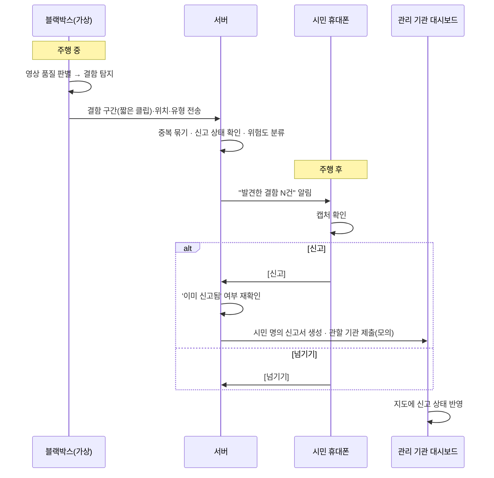
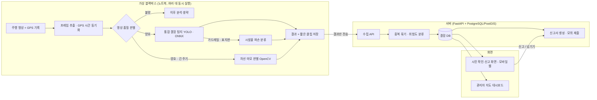

# 다보여 PRD (Product Requirements Document)

> 블랙박스 탑재형 AI 도로 결함 탐지 및 간편 신고 시스템

| 항목 | 내용 |
|---|---|
| 문서 버전 | v0.4 (초안 · 일정, 주행 영상 확보 방식, AI Hub 데이터 확인 결과 반영) |
| 작성일 | 2026-11-13 |
| 기반 문서 | 프로젝트 기획안 (2026-11-04, 작성자 정현우) |
| 대상 행사 | 2026 세종대학교 컴퓨터공학과 학술제 · 컴퓨터비전 트랙 |
| 완성 기한 | **2026-11-27 (금)** — 작성일 기준 D-14 |
| 팀 | 겸둥이 — 정현우(팀장, 백엔드 메인·AI 서브), 박겸(AI 메인) |
| 상태 | Draft (팀 검토 필요) |

> **표기 규칙**
> - 본문은 기획안 내용을 기준으로 정리했다.
> - 기획안에 없는 내용으로 PRD 작성 중 추가한 항목은 **`(제안)`** 으로 표시했다. 팀 합의 후 확정하거나 삭제한다.
> - 아직 정해지지 않은 수치·기준은 **`TBD`** 로 남기고 [18. 오픈 이슈](#18-오픈-이슈-결정-필요)에 모았다.

---

## 1. 개요

### 1.1 한 줄 요약

시민 차량의 블랙박스가 주행 중 도로 결함(포트홀·균열·차선 마모·가드레일/표지판 파손)을 **기기 안에서 직접** 찾고, 서버가 여러 차량의 관측을 하나로 정리하면, 시민은 **주행 후 휴대폰에서 버튼 한 번**으로 본인 명의 신고를 한다.

### 1.2 문서 범위

- 이 PRD는 **학술제 시연 버전(MVP)** 의 요구사항을 정의한다.
- 실제 블랙박스 탑재, 기관 시스템 연동 등 실서비스 요소는 [17. 확장 로드맵](#17-확장-로드맵-이번-버전-범위-밖)으로 분리했다.

---

## 2. 문제 정의

| # | 문제 | 현재 상황 | 다보여의 접근 |
|---|---|---|---|
| P1 | 발견 지연 | 도로 결함은 대부분 도로 순찰이나 시민 신고에 의존해 늦게 발견되고, 차량 파손·2차 사고로 이어진다 | 이미 보급된 블랙박스를 도로 관리용 센서망으로 활용 |
| P2 | 커버리지 한계 | 서울·용인·수원 등의 AI 포트홀 탐지는 지자체와 계약한 버스·택시·관용차에 한정 → 골목길·이면도로는 사각지대 | 시민 누구나 블랙박스 등록만으로 참여 |
| P3 | 탐지 대상 한정 | 기존 사업은 포트홀 한 가지에 집중 | 노면(포트홀·균열), 노면 표시(차선 마모), 도로 옆 시설물(가드레일·표지판 파손)을 한 번에 탐지 |
| P4 | 시민 신고 부담 | 서울시 신고포상 제도가 있지만, 운전 중 촬영·신고서 작성은 번거롭고 위험해 꾸준한 신고가 어렵다 | 운전 중 조작 없음, 주행 후 버튼 한 번 신고 |
| P5 | 행정 부담 | 담당 공무원이 중복 민원 처리·사진 확인을 직접 해야 한다 | 중복이 정리되고 AI 신뢰도·관측 차량 수가 적힌 신고 제공 |

### 2.1 관련 제도 (요구사항에 직접 영향)

「서울특별시 도로 등 주요시설물 관리에 관한 조례」, 「서울특별시 도로 파손 등 신고포상금 지급규칙」

- 대상: **서울시가 관리하는 도로**의 파손
- 조건: **분기별 5건 이상** 신고한 시민에게 누적 신고 건수에 따라 상품권 지급
- 제외: **이미 신고되어 복구 중인 파손**, **익명·타인 명의 신고**

→ 이 제약이 다음 요구사항으로 이어진다: 본인 명의 신고서(F6), 이미 신고된 결함 제외(F5), 포상 대상 도로 표시·분기 현황(F6, F8).

---

## 3. 목표와 비목표

### 3.1 제품 목표 (실서비스 관점)

| ID | 목표 |
|---|---|
| G1 | 이미 수많은 차량에 달린 블랙박스를 도로 관리용 센서망으로 만든다 |
| G2 | 블랙박스 화면에 보이는 도로 전체의 결함을 한 번에 찾는다 |
| G3 | 영상은 기기 안에서 분석하고 결과만 보내 대용량 영상 전송 없이 데이터를 모은다 |
| G4 | 시민은 운전 중 아무것도 하지 않고, 주행 후 버튼 한 번으로 신고한다 |
| G5 | 관리 기관은 중복이 정리되고 검증된 신고를 받아 급한 결함부터 처리한다 |

### 3.2 이번 버전(학술제) 목표

1. **블랙박스 탐지 → 서버 분석(중복 정리·위험도 분류) → 주행 후 확인 → 간편 신고 → 지도 반영**까지 하나의 흐름을 **실제 블랙박스 영상으로** 시연한다.
2. 기술 효과를 **측정 수치로** 보여준다: 처리 속도(분석 주기 적용 전후), 통신량 절감, 중복 정리 결과, 날씨·시간대별 탐지 성능.

### 3.3 비목표 (이번 버전에서 하지 않는 것)

| 하지 않는 것 | 대신 하는 것 |
|---|---|
| 실제 블랙박스 기기 탑재 | 노트북의 **가상 블랙박스 프로그램**으로 재현 |
| 저사양 보드(라즈베리파이 등) 실측 | **CPU 1~2코어 제한** 환경에서 측정해 저사양 환경을 가정 |
| 관할 기관 자동 접수 연동 | 신고서 생성 + **모의 제출** |
| 네이티브 앱·실제 푸시 알림 | **휴대폰 화면 형태의 웹 페이지** |
| 실제 회원가입·본인인증 | 시연용 가상 사용자 계정 `(제안)` |
| 낙하물·사고 현장 등 즉시 위험 탐지, 악화 추적, 원격 모델 업데이트 등 | 확장 로드맵으로 제시 |

---

## 4. 사용자와 이해관계자

| 구분 | 누구 | 니즈 | 이번 버전의 접점 |
|---|---|---|---|
| **시민 운전자** | GPS 내장/외장 블랙박스를 단 차량 운전자 (택배·배달·화물 차량 포함) | 운전 중 위험한 조작 없이 신고, 포상 기준 달성 | 주행 후 확인·신고 화면 (모바일 웹) |
| **관리 기관 담당자** | 지자체 도로 관리 공무원 | 중복 없는 검증된 신고, 급한 결함 우선 처리 | 관리자용 지도 대시보드, 신고서 |
| 블랙박스 제조사 | 실서비스 시 협업 파트너 | 추가 하드웨어 비용 없이 SW 업데이트로 차별 기능 확보, 데이터 사업 | 이번 버전에는 없음 |
| 학술제 심사위원·관람객 | 시연 대상 | 흐름이 끝까지 동작하는지, 기술적 근거가 있는지 | 시연 전체 + 실험 결과 |

---

## 5. 서비스 흐름과 사용자 스토리

### 5.1 전체 서비스 흐름



### 5.2 사용자 스토리

| ID | 사용자 | 원하는 것 | 이유 | 관련 기능 |
|---|---|---|---|---|
| US-01 | 시민 | 운전 중에는 아무것도 하지 않아도 결함이 기록되길 원한다 | 운전 중 휴대폰 조작은 위험하다 | F1, F2 |
| US-02 | 시민 | 주행 후 발견된 결함을 캡처와 함께 목록으로 보고 싶다 | 진짜 결함인지 직접 확인하고 싶다 | F6 |
| US-03 | 시민 | 버튼 한 번으로 본인 명의 신고서가 작성되길 원한다 | 신고서 작성이 번거롭다 | F6 |
| US-04 | 시민 | 이미 신고된 결함은 다시 묻지 않길 원한다 | 헛수고이고 포상에서도 제외된다 | F5 |
| US-05 | 시민 | 포상 대상 도로인지, 이번 분기 기준까지 몇 건 남았는지 알고 싶다 | 꾸준히 참여할 동기가 된다 | F6, F8 |
| US-06 | 담당 공무원 | 같은 결함은 한 건으로, AI 신뢰도·관측 차량 수와 함께 받고 싶다 | 중복 민원과 사진 확인 부담을 줄이고 싶다 | F5, F7 |
| US-07 | 담당 공무원 | 결함의 위치·유형·위험도·신고 상태를 지도로 한눈에 보고 싶다 | 급한 결함부터 처리하고 싶다 | F4, F9 |

---

## 6. 시스템 구성

### 6.1 아키텍처



### 6.2 구성 요소와 담당

| 구성 요소 | 역할 | 기술 | 담당 |
|---|---|---|---|
| 통합 결함 탐지 모델 | 포트홀·균열·가드레일·표지판 4종을 하나의 모델로 탐지 | PyTorch, Ultralytics YOLO, ONNX | 박겸 |
| 시설물 파손 분류 모델 | 탐지된 가드레일·표지판 영역을 정상/파손으로 분류 | Ultralytics YOLO(분류) | 박겸 |
| 차선 마모 판별 | 학습 없이 영상 처리로 차선 선명도 측정 | OpenCV | 박겸 |
| 영상 품질 판별 | 노면이 잘 안 보이는 구간 제외 | OpenCV `(제안)` | 정현우 |
| 가상 블랙박스 프로그램 | 프레임 추출, GPS 동기화, 분석 주기 적용, 결과 전송 | Python | 정현우 |
| 서버·DB | 수집, 중복 정리, 위험도 분류, 신고서 생성 | FastAPI, PostgreSQL + PostGIS | 정현우 |
| 시민 화면·관리자 대시보드 | 확인·신고 화면, 지도 | Streamlit 또는 웹 지도(Leaflet / 카카오맵 API) | 정현우 |
| 학습 환경 | 모델 학습 | Google Colab | 박겸 |

---

## 7. 기능 요구사항

### 7.0 기능 요약

우선순위 정의 `(제안)` — **P0**: 없으면 시연 흐름이 끊김 / **P1**: 완성도를 높이지만 빠져도 흐름은 유지 / **P2**: 여유가 있을 때

| ID | 기능 | 우선순위 `(제안)` | 담당 |
|---|---|---|---|
| F1 | 블랙박스 결함 탐지 | P0 (시설물 파손 판정만 P1, 대체안 있음) | 박겸 (가상 블랙박스 통합: 정현우) |
| F2 | 탐지 결과 수집 | P0 | 정현우 |
| F3 | 영상 품질 판별 | P0 | 정현우 |
| F4 | 위치 기록 및 위험도 분류 | P0 | 정현우 |
| F5 | 중복 정리 및 신고 상태 확인 | P0 | 정현우 |
| F6 | 주행 후 확인·간편 신고 | P0 | 정현우 |
| F7 | 오신고 방지 | P0 | 정현우 (임계값은 박겸의 성능 평가 결과로 결정) |
| F8 | 포상 현황 안내 | P1 | 정현우 |
| F9 | 도로 상태 지도 | P0 | 정현우 |

> 일정이 밀리면 [15.3 컷 라인](#153-컷-라인-일정이-밀릴-때-빼는-순서-제안) 순서대로 범위를 줄인다.

---

### F1. 블랙박스 결함 탐지

블랙박스 안에서 주행 영상을 실시간으로 분석해 도로 전체의 결함을 탐지하고, 결함이 찍힌 짧은 구간과 위치·유형 정보만 저장한다.

| ID | 요구사항 |
|---|---|
| FR-1.1 | **통합 탐지 모델 하나**로 포트홀·균열·가드레일·표지판 4종을 탐지한다. 학습 데이터는 RDD2022·AI Hub 도로장애물/표면 인지 영상(포트홀·균열)과 AI Hub 전국 도로시설물 영상정보 데이터 = KRID(가드레일·표지판)를 합친다 (→ [8.1](#81-데이터)). |
| FR-1.2 | 가드레일·표지판이 탐지되면 해당 영역만 잘라 **정상/파손 분류 모델**로 판정한다. 결과는 확정이 아닌 **'파손 의심'** 으로 표시한다. |
| FR-1.3 | **차선 마모**는 별도 학습 없이 영상 처리로 차선 영역을 찾고, 차선과 주변 노면의 밝기 대비를 수치로 측정해 선명도가 기준(TBD)보다 낮으면 마모로 판정한다. 품질 판별을 통과한 구간에서만 판정하고, **같은 지점을 여러 번 관측해** 확정한다. |
| FR-1.4 | 모든 분석을 매 프레임 실행하지 않고 **유형별 분석 주기**를 적용한다 (→ [8.3](#83-유형별-분석-주기)). |
| FR-1.5 | 결함이 탐지되면 **결함이 찍힌 짧은 구간(클립)·캡처·위치·유형·신뢰도만** 저장한다. 블랙박스 원본 영상이 덮어써져도 이 구간은 따로 남는다. 클립 길이는 TBD. |
| FR-1.6 | 탐지 모델을 **ONNX로 변환**하고, GPU 없이 **CPU 1~2코어**만 쓰도록 제한한 환경에서 동작해야 한다. |

**수용 기준**
- [ ] 실제 주행 영상([8.5](#85-주행-영상과-gps-확보-제안)의 공개 영상)에서 4종 각각에 대한 탐지 결과가 나온다.
- [ ] CPU 1~2코어 제한 환경에서 시연 영상을 처리할 수 있다 (목표 처리 속도 TBD).
- [ ] 분석 주기 적용 **전/후** 처리 속도 비교 결과가 있다.

**대체안 (위험 대응)** — 파손 시설물 데이터가 충분히 모이지 않으면, 시설물은 **위치 탐지까지만 시연**하고 파손 판정은 확장 과제로 넘긴다.

---

### F2. 탐지 결과 수집

| ID | 요구사항 |
|---|---|
| FR-2.1 | 가상 블랙박스는 **원본 영상 대신** 탐지 결과(유형·신뢰도·좌표·시각)와 캡처·짧은 클립만 서버로 보낸다. |
| FR-2.2 | 가상 블랙박스 여러 개를 동시에 실행해도 서버가 차량별로 구분해 저장한다. |
| FR-2.3 | 각 가상 블랙박스는 주행 종료를 서버에 알린다 (주행 후 알림의 트리거). `(제안)` |
| FR-2.4 | 전송 실패 시 로컬에 보관했다가 재전송한다. `(제안, P2)` |

**수용 기준**
- [ ] 가상 블랙박스 여러 대(대수 TBD)를 동시에 실행했을 때 모든 결과가 누락 없이 저장된다.
- [ ] 원본 영상 크기 대비 실제 전송량을 측정해 **통신량 절감률**을 제시할 수 있다.

---

### F3. 영상 품질 판별

| ID | 요구사항 |
|---|---|
| FR-3.1 | 비·눈·역광·야간 등으로 노면이 잘 보이지 않는 구간을 판정해 **이후 분석을 생략**한다. |
| FR-3.2 | 가벼운 연산으로 **다른 분석보다 먼저** 실행한다. |
| FR-3.3 | 판별 방식 후보: 밝기 평균/히스토그램, 블러 정도(라플라시안 분산), 노면 영역 대비 등. 구현 시 확정. `(제안)` |

**수용 기준**
- [ ] 품질 불량으로 판정된 구간에서 탐지가 실행되지 않았음이 로그로 확인된다.
- [ ] 품질 판별 적용 전/후 오탐지 수를 비교할 수 있다.

> 근거: 같은 도로를 여러 차량이 반복해서 지나므로, 품질이 나쁜 구간을 걸러내도 충분한 데이터를 확보할 수 있다.

---

### F4. 위치 기록 및 위험도 분류

| ID | 요구사항 |
|---|---|
| FR-4.1 | 프레임 시각과 GPS 기록의 시간을 맞춰, **탐지 시점의 GPS 좌표**를 결함 위치로 기록한다. |
| FR-4.2 | 결함 유형과 크기에 따라 위험도를 2단계로 나눈다. |
| FR-4.3 | 크기를 위험도에 반영하는 규칙은 TBD (→ 오픈 이슈 #5). |
| FR-4.4 | GPS 입력은 `시각, 위도, 경도` CSV 한 가지 형식으로 받는다. 실제 블랙박스 GPS 기록이든 재구성한 경로든 같은 방식으로 읽는다 (→ [8.5](#85-주행-영상과-gps-확보-제안)). `(제안)` |

| 결함 유형 | 위험도 | 근거 |
|---|---|---|
| 포트홀 | **빠른 보수** | 사고로 이어지기 쉬움 |
| 가드레일 파손 | **빠른 보수** | 사고로 이어지기 쉬움 |
| 균열 | 정기 보수 | |
| 차선 마모 | 정기 보수 | |
| 표지판 훼손 | 정기 보수 | |

**수용 기준**
- [ ] 저장된 모든 결함에 좌표와 위험도가 있다.

---

### F5. 중복 정리 및 신고 상태 확인

| ID | 요구사항 |
|---|---|
| FR-5.1 | 탐지 결과를 위치 DB(PostGIS)에 저장하고, **일정 거리(TBD m) 안의 같은 유형 결함을 하나로 묶는다.** |
| FR-5.2 | 결함은 신고 상태 **미신고 / 신고됨 / 보수 중** 중 하나를 가진다. |
| FR-5.3 | 신고됨·보수 중인 결함은 시민에게 신고를 묻지 않는다. |
| FR-5.4 | 여러 시민이 같은 결함을 발견하면 **먼저 확인한 시민의 신고만 접수**하고, 나머지 관측은 결함의 신뢰도(관측 차량 수)를 높이는 데 쓴다. |
| FR-5.5 | 신고 요청 시점에 서버가 상태를 **다시 확인**한다. 동시에 신고가 들어와도 1건만 접수되도록 한다 (예: 결함당 신고 1건 유니크 제약 또는 행 잠금). `(제안)` |

**수용 기준**
- [ ] 같은 차량의 여러 회 주행 영상을 서로 다른 가상 블랙박스에 넣어 보냈을 때, 같은 결함이 **하나로 묶인다.**
- [ ] 두 시민이 같은 결함을 거의 동시에 신고해도 **1건만** 접수되고, 다른 시민에게는 '이미 신고됨'이 안내된다.

---

### F6. 주행 후 확인·간편 신고

| ID | 요구사항 |
|---|---|
| FR-6.1 | 주행이 끝나면 휴대폰으로 **"발견한 결함 N건"** 을 알린다. (시연: 휴대폰 화면 형태의 웹 페이지) |
| FR-6.2 | 결함마다 캡처, 유형, 위치, **포상 대상 도로인지 여부**를 보여준다. 위험도·AI 신뢰도·관측 차량 수도 함께 보여준다. `(제안: 뒤의 세 항목)` |
| FR-6.3 | 시민은 결함마다 **[신고]** 또는 **[넘기기]** 를 선택한다. |
| FR-6.4 | [신고]를 누르면 서버가 '이미 신고됨' 여부를 재확인한 뒤, **사진·위치·유형·AI 신뢰도·관측 차량 수**가 담긴 신고서를 **본인 명의로 자동 작성**하고 관할 기관에 (모의) 제출한다. |
| FR-6.5 | 재확인 결과 이미 신고된 결함이면 신고서를 만들지 않고 안내 메시지를 보여준다. `(제안)` |
| FR-6.6 | 운전 중에는 화면을 조작할 필요가 없다 (주행 중 시민 화면 없음). |

**수용 기준**
- [ ] 시연에서 알림 → 캡처 확인 → 신고 → 신고서 생성 → 대시보드 반영이 끊김 없이 이어진다.
- [ ] 생성된 신고서에 사진·위치·유형·AI 신뢰도·관측 차량 수·신고자가 모두 들어 있다.

---

### F7. 오신고 방지

| ID | 요구사항 |
|---|---|
| FR-7.1 | **신뢰도 기준(TBD)을 넘거나 여러 차량(TBD대 이상)이 확인한** 결함만 시민에게 보여준다. |
| FR-7.2 | 시설물 '파손 의심'은 **여러 차량이 확인한 경우에만** 신고를 제안한다. |
| FR-7.3 | 신고서에 AI 신뢰도와 관측 차량 수를 함께 적어 담당 공무원이 쉽게 판단하게 한다. |

**수용 기준**
- [ ] 노출 기준에 못 미치는 결함은 시민의 확인 목록에 나타나지 않는다.

---

### F8. 포상 현황 안내

| ID | 요구사항 |
|---|---|
| FR-8.1 | 이번 분기 **유효 신고 건수**와 **포상 기준(분기 5건)까지 남은 건수**를 보여준다. |
| FR-8.2 | 유효 신고 = 포상 대상 도로 + 본인 명의 + 이미 신고·복구 중인 건이 아님. |
| FR-8.3 | 포상 대상 도로 판별 기준·데이터는 TBD (→ 오픈 이슈 #7). |

> 포상은 해당 제도의 대상 도로에 한한다는 점을 화면에 명시한다.

**수용 기준**
- [ ] 포상 대상 도로의 결함을 신고하면 유효 신고 건수가 바로 1 늘어난다.

---

### F9. 도로 상태 지도 (관리자용 대시보드)

| ID | 요구사항 |
|---|---|
| FR-9.1 | 탐지된 결함의 **위치·유형·위험도·신고 상태**를 웹 지도 위에 보여준다. |
| FR-9.2 | 유형·위험도·상태별 필터. `(제안)` |
| FR-9.3 | 마커를 누르면 캡처, 관측 차량 수, 신고서 내용을 보여준다. `(제안)` |
| FR-9.4 | 시연용으로 결함 상태를 '보수 중'으로 바꿀 수 있다 (기관 연동 대체). `(제안)` |

**수용 기준**
- [ ] 시민이 신고하면 해당 결함 마커의 상태가 곧바로 '신고됨'으로 바뀐다.

---

## 8. AI·비전 상세

### 8.1 데이터

| 데이터 | 용도 | 비고 |
|---|---|---|
| RDD2022 | 포트홀·균열 탐지 학습 | 공개 데이터 |
| AI Hub **전국 도로시설물 영상정보 데이터** (= KRID) | 가드레일·표지판 탐지 학습, **시설물 파손 분류 학습** | 시설물 34종, 라벨 이미지 20만 장. **v0.3까지의 '파손 여부 라벨 없음'은 틀렸다**: 객체마다 `state: 정상/파손` 필드가 있다. 가드레일(`방호울타리`)은 폴리곤 라벨만 있어 박스로 변환해야 한다 |
| 파손 시설물 이미지 | 파손 분류 학습 **보조** | KRID의 파손 라벨이 학습하기에 부족할 때만 주행 영상·공개 이미지에서 추가 수집 |
| 공개 주행 영상 (유튜브 등) | 성능 확인·시연 | 기획안의 '직접 촬영'에서 **변경**: 촬영이 어려워 공개 영상을 쓴다. GPS는 [8.5](#85-주행-영상과-gps-확보-제안) 방식으로 확보 |
| AI Hub **도로장애물/표면 인지 영상(수도권)** `(제안)` | 국내 도로 포트홀·균열 추가 학습 | 포트홀 10만(박스), 크랙 30만(**세그멘테이션 마스크** → 박스 변환 필요), 보수완료 포트홀·맨홀(박스). RDD2022에는 한국 도로 이미지가 없으므로 국내 도로 성능 보강용 |

#### 8.1.1 AI Hub 다운로드 범위 `(제안)`

두 데이터셋 모두 1 TB가 넘는다. **라벨 파일을 먼저 받아 클래스 수를 센 뒤**, 필요한 이미지 zip만 받는다. 신청은 데이터 소개 페이지의 [다운로드] 버튼으로 하고(내국인만, 승인 필요), 승인 후 '파일 목록 (API 다운로드)'에서 파일을 골라 받는다.

| 데이터셋 | 먼저 받을 것 (라벨) | 다음에 받을 것 (이미지) | 받지 않을 것 |
|---|---|---|---|
| [전국 도로시설물 영상정보](https://www.aihub.or.kr/aihubdata/data/view.do?currMenu=115&topMenu=100&aihubDataSe=data&dataSetSn=71786) (1.68 TB) | `TL_*` 5개(약 390 MB), `VL_*` 5개(약 51 MB) | 도시부 `TS_2.국도_02.도시부`(8.76 GB), `TS_3.지방도_02.도시부`(0.69 GB), `VS_*` 5개(약 18.6 GB) | `Other_1~16`(개당 약 97 GB, 라벨 없는 원본), `Sublabel`(캡션) |
| [도로장애물/표면 인지 영상(수도권)](https://www.aihub.or.kr/aihubdata/data/view.do?currMenu=115&topMenu=100&aihubDataSe=data&dataSetSn=179) (1.01 TB) | `1.Training/1.Annotations`(약 1.04 GB), `2.Validation/1.Annotations`(약 0.17 GB) | `2.Validation` 이미지 중 `Mainroad`·`Frontback` (포트홀이 많은 TOA zip 2~4개 + CRACK) | `1.Training` 이미지 전체(약 927 GB) |

클래스 매핑

| 우리 클래스 | 전국 도로시설물 영상정보 | 도로장애물/표면 인지 영상 | RDD2022 |
|---|---|---|---|
| `pothole` | — | `포트홀` | D40 |
| `crack` | — | `크랙` (마스크 → 연결 영역별 박스) | D00·D10·D20 |
| `guardrail` | `방호울타리` (+ 필요 시 `중앙분리대`), 폴리곤 → 박스 | — | — |
| `sign` | `도로 표지`, `안전 표지`, `도로이정표`, `도로명판` | — | — |
| 쓰지 않음(배경) | 나머지 | `보수완료 포트홀`, `맨홀`(포트홀로 오인하기 쉬운 배경), 나머지 | 나머지 |

> 확인했지만 쓰지 않는 데이터: AI Hub 「지자체 도로부속시설물 파손 데이터」는 정상/파손 라벨이 있으나 PE드럼·라바콘·시선유도봉 등이고 가드레일·표지판이 없다. 「도로장애물/표면 인지 영상(수도권 외)」은 같은 형식으로, 포트홀이 부족할 때만 추가한다.

### 8.2 모델 구성

| 모듈 | 방식 | 입력 | 출력 |
|---|---|---|---|
| 통합 결함 탐지 | YOLO 단일 모델, 4클래스 (포트홀·균열·가드레일·표지판) | 프레임 | 박스, 클래스, 신뢰도 |
| 시설물 파손 분류 | 소형 분류 모델 | 가드레일·표지판 크롭 | 정상 / 파손 의심, 신뢰도 |
| 차선 마모 판별 | OpenCV 규칙 기반 (학습 없음) | 프레임의 차선 영역 | 밝기 대비 수치, 마모 여부 |
| 영상 품질 판별 | 경량 규칙 기반 `(제안)` | 프레임 | 양호 / 불량 |

모델을 하나로 합친 이유: 학습·경량화 부담과 연산량을 줄이기 위해.

### 8.3 유형별 분석 주기

| 순서 | 모듈 | 실행 조건 | 주기 |
|---|---|---|---|
| 1 | 영상 품질 판별 | 항상 먼저 | 짧음 (매 프레임 또는 근접) |
| 2 | 통합 결함 탐지 | 품질 양호 | 일정 간격 프레임 (TBD) |
| 3 | 시설물 파손 분류 | 가드레일·표지판이 **탐지된 경우에만** | 탐지 시 |
| 4 | 차선 마모 판별 | 품질 양호 | **더 긴 간격** (변화가 느리므로, TBD) |

### 8.4 경량화와 속도 측정

- 탐지 모델을 ONNX로 변환한다.
- CPU 1~2코어로 제한한 환경에서 측정한다 (예: ONNX Runtime 스레드 수 제한, 프로세스 CPU 고정). `(제안: 제한 방법)`
- 실험 1: 분석 주기 적용 **전/후** 처리 속도 비교
- 실험 2: **분석 간격 ↔ 결함 누락** 관계 (속도가 기대보다 낮을 때 간격 조정 근거)

### 8.5 주행 영상과 GPS 확보 `(제안)`

직접 촬영이 어려워 공개 주행 영상을 쓴다. 문제는 **유튜브 등에 올라온 영상에는 GPS 기록이 빠져 있다**는 점이다. 그래서 영상 출처와 GPS 확보 방법을 함께 정한다.

| 출처 | GPS | 장점 | 단점 | 용도 |
|---|---|---|---|---|
| **유튜브 국내 블랙박스·드라이브 영상** | 없음 → 경로 재구성 | 국내(서울) 도로, 블랙박스 화각 그대로, 서울 포상 대상 도로 시나리오와 맞음 | 좌표를 직접 만들어야 하고 위치 오차가 있음 | **시연 메인** |
| BDD100K | 있음 (휴대폰 GPS/IMU) | 실제 GPS, 날씨·시간대가 다양, 40초 클립 10만 개 | 미국 도로(뉴욕·샌프란시스코 등), 영상 용량이 매우 큼(전체 약 1.8TB) → 일부만 받기 | 실제 GPS로 위치 기록·중복 정리 검증 (보조) |
| Mapillary | 있음 (이미지마다 좌표) | 같은 도로를 다른 날짜에 찍은 시퀀스가 있으면 다중 차량 재현에 유리 | 영상이 아니라 일정 간격 사진, 서울 커버리지 직접 확인 필요, API 토큰 필요 | 백업 |

**유튜브 영상 고르는 기준**
- 경로를 알 수 있는 영상: 제목·설명에 출발지·도착지나 도로명이 있거나, 표지판으로 경로를 따라갈 수 있는 것
- **같은 도로를 지나는 영상 2개 이상**: 업로더가 다르면 실제로 '다른 차량'이 되어 중복 정리 시연이 더 자연스럽다
- 노면이 잘 보이는 화각, 1080p 이상, 낮·맑은 날 위주. 품질 판별 시연용으로 야간·우천 영상 1~2개 추가
- 검색어 예: `서울 블랙박스 주행`, `서울 드라이브 4K`, `(도로명) 주행 영상`, `포트홀 블랙박스`
- 발표 자료에 출처를 표기한다. 가능하면 크리에이티브 커먼즈 라이선스 영상을 고르거나 업로더에게 허락을 받는다

**GPS 경로 재구성 방법**
1. 영상을 보며 지나간 경로를 확인한다.
2. GPX 편집 도구(예: gpx.studio)에서 경로를 도로에 맞춰 그린다.
3. 교차로·육교처럼 알아보기 쉬운 지점 몇 곳을 기준점으로 정하고, 영상에서 그 지점을 지나는 시각을 기록한다.
4. 기준점 사이는 거리에 비례해 보간해서 `영상 시각 → 위도·경도` CSV를 만든다 (Python 스크립트).
5. 여유가 있으면: 블랙박스 화면에 속도가 표시되는 영상은 속도를 OCR로 읽어 누적 거리로 위치를 계산하면 더 정확하다.

> 발표 때 "GPS가 없는 공개 영상이라 경로를 재구성했다"고 밝힌다. 가상 블랙박스는 `시각, 위도, 경도` CSV만 읽으므로(FR-4.4), 나중에 실제 블랙박스 GPS 기록으로 바꿔도 다른 부분은 그대로다.

---

## 9. 데이터 모델 (초안) `(제안)`

> 정현우 담당 영역. 구현하면서 바뀔 수 있다.

**users** — 시민 (시연용 가상 사용자)

| 필드 | 타입 | 설명 |
|---|---|---|
| id | UUID | |
| name | text | 신고서에 들어갈 본인 명의 |

**vehicles** — 가상 블랙박스 1개 = 차량 1대

| 필드 | 타입 | 설명 |
|---|---|---|
| id | UUID | |
| owner_user_id | FK → users | 등록한 시민 |
| label | text | 시연용 이름 (예: 차량 A) |

**trips** — 주행 1회

| 필드 | 타입 | 설명 |
|---|---|---|
| id | UUID | |
| vehicle_id | FK → vehicles | |
| started_at / ended_at | timestamptz | ended_at이 채워지면 주행 후 알림 생성 |

**observations** — 블랙박스가 보낸 개별 탐지 결과(관측)

| 필드 | 타입 | 설명 |
|---|---|---|
| id | UUID | |
| trip_id, vehicle_id | FK | |
| defect_type | enum | `pothole`, `crack`, `lane_wear`, `guardrail_damage`, `sign_damage` |
| confidence | float | AI 신뢰도 |
| bbox | json | 프레임 내 위치 |
| size_metric | float | 위험도 판단용 크기 지표 (정의 TBD) |
| location | geography(Point, 4326) | 탐지 시점 GPS 좌표 |
| observed_at | timestamptz | |
| quality_score | float | 품질 판별 점수 |
| snapshot_path, clip_path | text | 캡처, 짧은 클립 |
| defect_id | FK → defects | 중복 묶기 결과 |

**defects** — 중복을 정리한 결함 (지도·신고의 단위)

| 필드 | 타입 | 설명 |
|---|---|---|
| id | UUID | |
| defect_type | enum | |
| location | geography(Point, 4326) | 대표 좌표 (관측 좌표의 중앙값 등) |
| risk_level | enum | `urgent`(빠른 보수), `routine`(정기 보수) |
| status | enum | `unreported`(미신고), `reported`(신고됨), `under_repair`(보수 중) |
| observation_count | int | 관측 횟수 |
| vehicle_count | int | 관측 차량 수 |
| confidence | float | 대표 신뢰도 |
| is_suspected | bool | 시설물 '파손 의심' 여부 |
| reward_eligible_road | bool | 포상 대상 도로 여부 |
| first_seen_at / last_seen_at | timestamptz | |

**findings** — 시민별 주행 후 확인 목록의 한 항목

| 필드 | 타입 | 설명 |
|---|---|---|
| id | UUID | |
| trip_id, user_id, defect_id | FK | |
| response | enum | `pending`, `reported`, `skipped`, `already_reported` |
| responded_at | timestamptz | |

**reports** — 신고서

| 필드 | 타입 | 설명 |
|---|---|---|
| id | UUID | |
| defect_id | FK, **UNIQUE** | 결함당 신고 1건 보장 (FR-5.5) |
| user_id | FK | 본인 명의 |
| quarter | text | 예: `2026-Q4` (포상 집계용) |
| payload | json | 사진·위치·유형·AI 신뢰도·관측 차량 수 |
| submission_status | enum | `generated`, `mock_submitted` |
| reward_valid | bool | 유효 신고 여부 |
| created_at | timestamptz | |

---

## 10. API 초안 `(제안)`

| 사용처 | 메서드 · 경로 | 설명 |
|---|---|---|
| 가상 블랙박스 | `POST /api/v1/trips` | 주행 시작 |
| 가상 블랙박스 | `POST /api/v1/observations` | 탐지 결과 일괄 전송 (캡처·클립 포함) |
| 가상 블랙박스 | `POST /api/v1/trips/{trip_id}/end` | 주행 종료 → 확인 목록 생성 |
| 시민 화면 | `GET /api/v1/trips/{trip_id}/findings` | 주행 후 확인 목록 (노출 기준 통과 + 미신고만) |
| 시민 화면 | `POST /api/v1/defects/{defect_id}/report` | 신고 (서버 재확인 후 신고서 생성) |
| 시민 화면 | `POST /api/v1/defects/{defect_id}/skip` | 넘기기 |
| 시민 화면 | `GET /api/v1/users/{user_id}/reward-status` | 이번 분기 유효 신고 수, 남은 건수 |
| 공통 | `GET /api/v1/reports/{report_id}` | 신고서 조회 |
| 관리자 대시보드 | `GET /api/v1/defects?type=&risk=&status=&bbox=` | 지도용 결함 목록 |
| 관리자 대시보드 | `PATCH /api/v1/defects/{defect_id}/status` | 시연용 상태 변경 |

`POST /report` 응답 예시

```json
// 접수 성공
{ "result": "reported", "report_id": "…", "reward_valid": true, "quarter_valid_count": 3, "remaining_to_reward": 2 }

// 이미 다른 시민이 신고
{ "result": "already_reported" }
```

---

## 11. 비기능 요구사항

| 구분 | 요구사항 |
|---|---|
| 성능 | GPU 없이 CPU 1~2코어 제한 환경에서 동작한다. 목표 처리 속도 TBD. |
| 통신량 | 원본 영상을 전송하지 않는다. 결과 + 짧은 클립만 보낸다. |
| 정합성 | 같은 결함에 대한 신고는 동시 요청이 와도 1건만 접수된다. |
| 다중 차량 | 가상 블랙박스 여러 대를 동시에 처리한다. |
| 사용성 | 운전 중 조작 0회. 주행 후 결함 1건당 탭 1번으로 신고. |
| 견고성 | 비·눈·역광·야간 구간은 품질 판별로 제외하고, 날씨·시간대별 성능을 측정해 한계를 공개한다. |
| 개인정보 `(제안)` | 서버에는 **주행 경로 전체가 아니라 결함 지점만** 전송된다 (설계상 장점, 발표 포인트). 캡처·클립 속 타인 차량 번호판·보행자 얼굴은 비식별화(블러)를 검토한다. 위치정보 처리에 관한 법적 검토는 실서비스 단계 과제로 둔다. |

---

## 12. 성공 지표와 실험 계획

| 영역 | 지표 | 측정 방법 | 목표 |
|---|---|---|---|
| 탐지 | 클래스별 mAP@0.5, Precision, Recall | 공개 데이터 테스트셋 + **실제 주행 영상(8.5) 별도** 평가 | TBD |
| 파손 분류 | Accuracy, F1 | 수집한 소량 데이터 홀드아웃 | TBD |
| 차선 마모 | 판정 정확도 | 주행 영상 구간에 수동 라벨 후 비교 `(제안)` | TBD |
| 처리 속도 | FPS / 영상 1분당 처리 시간 | CPU 1~2코어 제한, 분석 주기 적용 전/후 | TBD |
| 분석 간격 | 간격별 결함 누락률 | 간격을 바꿔가며 같은 영상 처리 | 그래프 제시 |
| 통신량 | 절감률 = 1 − (전송량 / 원본 영상 크기) | 가상 블랙박스 전송 바이트 집계 | TBD |
| 중복 정리 | 같은 결함이 하나로 묶인 비율 | 같은 차량 여러 회 주행 → 서로 다른 가상 블랙박스 | TBD |
| 품질 판별 | 적용 전/후 오탐지 수 | 악천후·야간 구간 포함 영상 | 감소 확인 |
| 환경별 성능 | 날씨·시간대별 탐지 성능 | 조건별로 나눈 영상 | 한계 제시 |

---

## 13. 시연 시나리오

| 단계 | 화면 | 보여줄 것 |
|---|---|---|
| 1 | 노트북 | 주행 영상 재생, 가상 블랙박스 실행 (여러 대 동시 실행 `(제안)`) |
| 2 | 가상 블랙박스 | 실시간 **품질 판별·결함 탐지** 결과 오버레이 |
| 3 | 가상 블랙박스 → 서버 | 결과 전송 (원본 대비 전송량 표시 `(제안)`) |
| 4 | 서버 | **중복 정리·위험도 분류** |
| 5 | 시민 화면 | 주행 후 "발견한 결함 N건" → 캡처 확인 |
| 6 | 시민 화면 | [신고] → **신고서 생성**(모의 제출), 포상 현황 갱신 |
| 7 | 관리자 대시보드 | 지도에 **신고 상태 반영** |
| 8 `(제안)` | 시민 화면 (두 번째 차량) | 이미 신고된 결함은 묻지 않음을 보여줌 |
| 9 | 발표 자료 | 실험 결과: 처리 속도, 통신량, 중복 정리, 환경별 성능 |

---

## 14. 역할 분담

| 담당 | 역할 | 업무 |
|---|---|---|
| **박겸** | AI 메인 | 데이터셋 통합·정제·라벨링, 통합 결함 탐지 모델 학습, 시설물 파손 분류 모델 학습, 차선 마모 판별(영상 처리), 모델 성능 평가, 경량화 및 처리 속도 측정 |
| **정현우** | 백엔드 메인, AI 서브 | 파손 이미지 수집·라벨링 지원, 영상 품질 판별, 가상 블랙박스 프로그램(프레임 추출·GPS 동기화·분석 주기 적용·결과 전송), 서버·DB 구축, 중복 정리·위험도 분류·신고서 생성 로직, 확인·신고 화면 및 지도 대시보드 |

**인터페이스 합의 필요 지점** `(제안)`
- 박겸 → 정현우: ONNX 모델 파일, 클래스 이름·순서, 입력 크기, 추론 결과 형식, 권장 신뢰도 임계값
- 정현우 → 박겸: 가상 블랙박스의 프레임 샘플링 방식, 속도 측정용 로그 형식

---

## 15. 일정 — 11/27(금) 완성 `(제안)`

> 작성일(11/13) 기준 **2주**. 두 사람이 병렬로 진행하고, 중간에 두 번 맞춰본다: **11/18 인터페이스 맞춤**, **11/21 첫 end-to-end**.

### 15.1 주차별 계획

| 기간 | 단계 | 박겸 (AI) | 정현우 (백엔드) | 완료 기준 |
|---|---|---|---|---|
| 11/13(금)~11/15(일) | **M0 준비** | RDD2022 확보, KRID 다운로드 신청·확보, 클래스 정의 확정(이슈 #1), 학습 데이터셋 v1 | **공개 주행 영상 선정 + GPS 경로 재구성** (같은 도로 영상 2개 이상, 8.5), DB 스키마, 화면 방식 결정(#11) | 데이터셋 v1, 시연용 영상 + 좌표 CSV 확보 |
| 11/16(월)~11/18(수) | **M1 골격** | 통합 탐지 모델 v1 학습(Colab) → ONNX 변환 | 수집 API, 가상 블랙박스(프레임 추출·GPS 동기화·전송) | **11/18 인터페이스 맞춤**: ONNX 모델 + 추론 결과 형식 전달 |
| 11/19(목)~11/21(토) | **M2 통합** | 차선 마모 판별, 파손 분류 학습 (KRID 파손 라벨, 부족하면 이미지 보충) | 품질 판별, 분석 주기, 중복 정리·위험도 분류 | **11/21 첫 end-to-end**: 영상 → 탐지 → 서버 DB에서 결함이 묶임 |
| 11/22(일)~11/24(화) | **M3 화면 · M4 실험** | 성능 평가, CPU 제한 속도 측정, 분석 간격 실험, 노출 임계값 결정(#3) | 확인·신고 화면, 신고서 생성, 지도 대시보드, 포상 현황 | 시연 시나리오 1~7단계 동작 |
| 11/25(수) | **기능 동결** | 실험 결과 정리 (12장 지표 표 채우기) | 버그 수정 | 새 기능 추가 중단 |
| 11/26(목) | **리허설** | 발표 자료에 수치 반영 | 시연 스크립트, 예외 상황 대비 | 끊김 없는 시연 2회 이상 |
| 11/27(금) | **완성** | | | |

### 15.2 결정 시점 (Go / No-go)

| 날짜 | 결정 | 기준 |
|---|---|---|
| 11/15(일) | 화면 구현 방식 | 기간을 생각하면 **Streamlit 하나로 시민 화면과 지도 대시보드를 모두** 만드는 쪽이 빠르다 |
| 11/18(수) | 모델 ↔ 가상 블랙박스 연결 | ONNX 모델이 가상 블랙박스에서 돌아가지 않으면, 우선 PyTorch 모델로 연결하고 ONNX는 속도 측정용으로만 쓴다 |
| 11/20(금) | **시설물 파손 판정 유지 여부** | 그때까지 파손 이미지(KRID 파손 라벨 + 보충 수집)가 학습할 만큼 모이지 않으면 **대체안(위치 탐지까지만)으로 확정**하고, 남는 시간을 다른 기능에 쓴다 |
| 11/21(토) | 위험도에 크기 반영 여부(#5) | end-to-end가 늦어지면 **유형만으로 분류**하고 크기 반영은 확장 과제로 넘긴다 |

### 15.3 컷 라인 (일정이 밀릴 때 빼는 순서) `(제안)`

1. P2 항목 전부: 전송 재시도(FR-2.4), 대시보드 필터·상세(FR-9.2·9.3), 번호판·얼굴 블러
2. 시설물 파손 분류 → 위치 탐지까지만 (기획안의 대체안)
3. 시연 8단계 (두 번째 차량의 '이미 신고됨' 시나리오)
4. 포상 현황 안내(F8) → 결함 카드의 '포상 대상 도로' 표시만 남김

**끝까지 지킬 것**: 탐지 → 전송 → 중복 정리 → 주행 후 확인·신고 → 신고서 → 지도 반영. 이 흐름이 시연의 전부다.

---

## 16. 리스크와 대응

| 리스크 | 대응 |
|---|---|
| **블랙박스 탑재 불가** — 블랙박스 SW는 제조사만 수정 가능 | 노트북의 가상 블랙박스 프로그램으로 재현, CPU 제한 측정으로 저사양 환경 가정. 실제 기기 검증은 확장 과제 |
| **기관 접수 연동 불가** — 자동 접수용 공개 연동 창구 없음 | 신고서 생성 + 모의 제출까지 구현 |
| **GPS** | 기획안: GPS 내장·외장 블랙박스 영상 사용 → **변경**: 공개 영상에는 GPS가 없으므로 경로를 재구성한다 (8.5). 실제 GPS로 검증해야 하면 BDD100K로 보조 |
| **시설물 파손 데이터 부족** — 파손 시설물 자체가 드묾 | v0.4: KRID(전국 도로시설물 영상정보)에 `정상/파손` 라벨이 있으므로 이것을 먼저 쓴다. 라벨을 세어 파손이 부족하면 주행 영상·공개 이미지에서 보충. '파손 의심'으로 표시해 여러 차량이 확인한 경우에만 신고 제안. 그래도 부족하면 위치 탐지까지만 시연 |
| **처리 속도 미달** | 분석 간격을 조정하고, 간격에 따른 처리 속도와 결함 누락의 관계를 실험 결과로 제시 |
| **차선 마모 판정 기준 흔들림** — 조명·날씨에 따라 밝기 대비가 달라짐 | 품질 판별 통과 구간에서만 판정, 같은 지점 여러 번 관측해 확정 |
| **여러 차량 검증 어려움** | 기획안: 같은 차량의 여러 회 주행 영상을 각각 다른 가상 블랙박스에 넣어 전송 → **변경**: 같은 도로를 지나는 공개 영상 2개 이상을 각각 다른 가상 블랙박스에 넣는다. 못 구하면 한 영상을 여러 가상 블랙박스에 넣고 좌표에 작은 오차를 섞어 보낸다 |
| **악천후·야간** | 품질 판별로 저신뢰 구간 제외, 날씨·시간대별 탐지 성능을 측정해 한계 제시 |
| **개발 기간 2주** `(제안)` | 11/21 end-to-end를 기준점으로 삼고, 늦어지면 15.3 컷 라인 순서대로 범위 축소 |
| **주행 영상 확보 지연** `(제안)` | 모든 작업이 이 영상에 걸려 있으므로 첫 주말(11/14~15)에 영상 선정과 GPS 경로 재구성을 끝낸다. 날씨·야간 영상은 구해지는 만큼만 실험에 쓴다 |
| **AI Hub 데이터 확보 지연·대용량** `(제안)` | AI Hub는 다운로드 신청·승인이 필요하고 두 데이터셋 모두 1 TB가 넘는다. 받기 전에는 RDD2022(포트홀·균열)로 먼저 학습하고, 승인 후에는 라벨만 먼저 받아 필요한 이미지 zip만 고른다 (8.1.1) |
| **Colab 학습 시간** `(제안)` | 작은 YOLO 모델(n/s급)과 데이터 샘플링으로 1회 학습 시간을 줄이고, 학습은 밤사이에 돌린다 |

---

## 17. 확장 로드맵 (이번 버전 범위 밖)

| 항목 | 내용 |
|---|---|
| 실제 서비스화 | 블랙박스 제조사와 협업해 실제 기기에 탑재, 지자체 신고 시스템과 연동해 바로 접수 |
| 저사양 기기 검증 | 라즈베리파이 등 블랙박스와 비슷한 저사양 보드에서 실제 처리 속도 측정 |
| 원격 모델 업데이트 | 개선된 모델을 블랙박스에 무선 배포 |
| 탐지 유형 확대 | 낙하물·사고 현장·고장 차량·침수·결빙 등 돌발 위험 추가, 즉시 위험은 주변 운전자·관리 기관에 자동 알림 |
| 정밀 위치·매칭 | 카메라 높이·각도로 위치 보정, 영상 특징 매칭으로 동일 결함 판별 정확도 향상 |
| 악화 추적·예보 | 같은 결함의 날짜별 변화로 악화 속도 측정, 균열 단계 예방 정비 |
| 관리 기관 기능 | 보수 우선순위 추천, 장마·해빙기 전후 집중 점검, 보수 완료 자동 확인 |
| 운전자 안전 | 즉시 위험을 같은 도로의 다른 차량 블랙박스·내비게이션에 실시간 공유 |
| 모델 고도화 | 기관이 '결함 없음'으로 처리한 신고를 오탐 데이터로 재학습 |

### 기대 효과 (기획안 요약)

- **데이터 수집**: 택배·배달·화물 차량이 움직이는 점검 카메라가 되어 고정 CCTV가 닿지 않는 골목길·이면도로까지 더 자주 살핀다.
- **시민 참여**: GPS·통신 블랙박스라면 SW 업데이트와 등록만으로 참여, 포상 기준 달성이 쉬워진다.
- **공익**: 결함을 더 빨리 발견·보수해 차량 파손과 2차 사고를 줄인다.
- **행정 효율**: 중복 민원 처리·사진 확인 부담 감소.
- **공평한 도로 관리**: 민원·순찰 노선이 아닌, 차량이 지나는 도로를 같은 기준으로 살핀다.
- **제조사 유인**: 하드웨어 비용 없이 차별 기능 확보, 도로 데이터 사업(지자체·내비게이션·보험사)으로 통신 비용 충당.
- **기술**: 세 가지 판정을 하나의 블랙박스 프로그램에 통합, 엣지 판단 + 다중 차량 서버 구조의 효과를 수치로 제시.
- **데이터 활용**: 지점별 결함 이력이 보수 계획·예산의 근거가 되고, 내비게이션·자율주행·보험 분야로 확장 가능.

---

## 18. 오픈 이슈 (결정 필요)

| # | 이슈 | 선택지 / 메모 | 담당 `(제안)` | 기한 `(제안)` |
|---|---|---|---|---|
| 1 | **균열 클래스 구성** | RDD2022는 균열을 세부 유형(세로·가로·거북등 균열 등)으로 나눠 라벨링한다. '균열' 하나로 합칠지, 세부 유형을 유지할지 | 박겸 | 11/14 |
| 13 | **주행 영상 출처** | 유튜브 국내 영상 + 경로 재구성(추천) / BDD100K / Mapillary (8.5) | 팀 | 11/14 |
| 11 | **화면 구현 방식** | Streamlit vs 웹 지도(Leaflet / 카카오맵 API). 일정상 Streamlit 하나로 통일하는 쪽이 빠름 | 정현우 | 11/15 |
| 12 | **개인정보 비식별화 범위** | 캡처·클립 속 번호판·얼굴 블러를 이번 버전에 넣을지. 일정상 시간이 남을 때만 | 팀 | 11/15 |
| 4 | **"먼저 확인한 시민"의 정의** | 먼저 [신고]를 누른 시민인지, 먼저 탐지한 차량의 시민인지. 먼저 탐지한 시민이 [넘기기] 하면 다음 시민에게 넘어가는지 | 정현우 | 11/18 |
| 8 | **넘기기한 결함 처리** | 같은 시민이 다음 주행에서 다시 마주치면 또 물을지 | 정현우 | 11/18 |
| 10 | **짧은 클립 길이·형식** | 결함 전후 몇 초, 해상도, 저장 형식 | 정현우 | 11/18 |
| 7 | **포상 대상 도로 판별 데이터** | '서울시가 관리하는 도로'인지 판별할 데이터 출처. 못 구하면 시연용으로 일부 구간을 지정 | 정현우 | 11/20 |
| 2 | **중복 묶기 거리 기준** | GPS 오차, "차량 위치 ≠ 결함 위치" 차이, 재구성 경로의 오차를 고려해 몇 m로 할지. 참고: 사업용 차량 GPS 실험에서 20m 범위가 동일 지점 인식률 90% 이상이었다는 연구가 있다 | 정현우 | 11/21 |
| 5 | **크기를 위험도에 반영하는 방법** | 박스 크기는 거리에 따라 달라짐 → 화면 하단 노면 영역 기준 정규화 등. 늦어지면 유형만으로 분류 | 박겸 + 정현우 | 11/21 |
| 6 | **차선 마모 확정 규칙** | 몇 번 관측되어야 확정할지, 밝기 대비 기준값 | 박겸 | 11/22 |
| 9 | **'보수 중' 상태 전환 주체** | 시연에서는 관리자 대시보드에서 수동 변경 (FR-9.4) | 정현우 | 11/22 |
| 3 | **노출 기준 (F7)** | 신뢰도 임계값 θ, 최소 관측 차량 수 k. 박겸의 성능 평가 결과로 결정 | 박겸 + 정현우 | 11/24 |

> 기한 순으로 정렬했다. 번호는 v0.1의 이슈 번호를 그대로 유지한다.

---

## 부록. 용어 정의

| 용어 | 정의 |
|---|---|
| 가상 블랙박스 | 노트북에서 블랙박스 역할을 하는 프로그램. 영상에서 프레임을 뽑아 GPS와 맞추고 분석해 결과를 서버로 보낸다. 여러 개를 동시에 실행해 여러 차량을 재현한다. |
| 관측 (observation) | 블랙박스 하나가 한 시점에 탐지한 결함 결과 1건 |
| 결함 (defect) | 여러 관측을 중복 정리해 하나로 묶은 실제 도로 결함. 지도 표시와 신고의 단위 |
| 주행 (trip) | 블랙박스 1대의 주행 1회. 종료 시 시민에게 확인 목록을 보낸다 |
| 짧은 구간 (클립) | 결함이 찍힌 전후 몇 초 분량의 영상. 원본 영상이 덮어써져도 남는다 |
| 파손 의심 | 시설물 파손 분류 결과. 데이터가 적어 확정하지 않고 여러 차량 확인 시에만 신고를 제안한다 |
| 노출 기준 | 시민의 확인 목록에 결함을 보여주기 위한 최소 조건 (신뢰도 또는 관측 차량 수) |
| 유효 신고 | 포상 집계에 들어가는 신고. 포상 대상 도로 + 본인 명의 + 이미 신고·복구 중이 아닌 건 |
