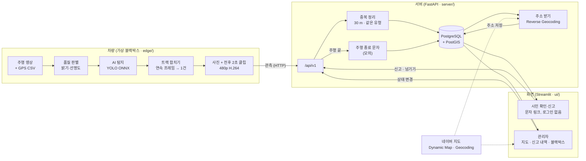
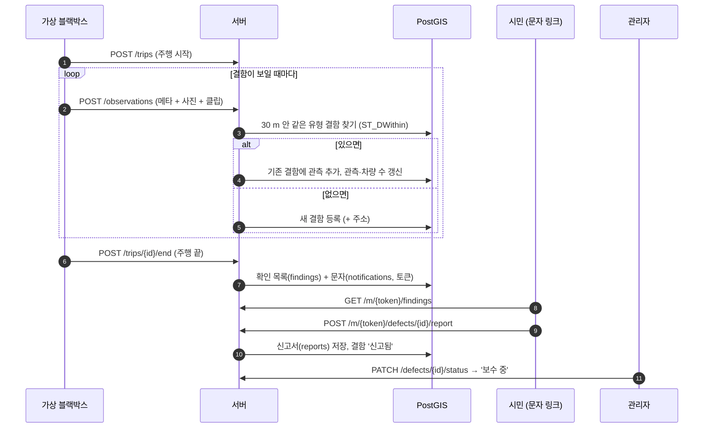
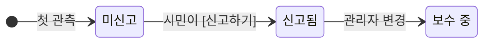
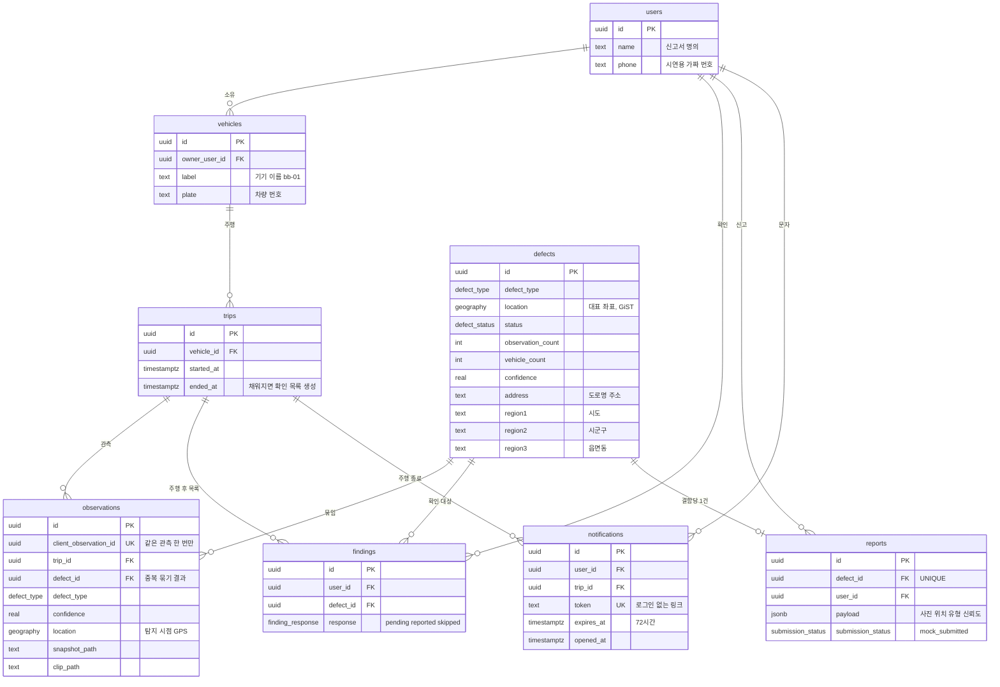

<div align="center">

# 다보여 · Daboyeo

블랙박스 영상에서 **도로 결함**(포트홀·균열·가드레일·표지판)을 AI로 찾고,<br>
서버가 여러 차량의 관측을 하나로 묶어 **시민이 버튼 한 번으로 신고**하게 하는 시스템

[](#빠른-시작)
[](#api)
[](#데이터-모델)
[](#화면)
[](#탐지-모델)
[](#빠른-시작)

2026 세종대학교 컴퓨터공학과 학술제 MVP

[PRD](PRD.md) · [실행 계획](docs/plan.md) · [협업 규칙](CONTRIBUTING.md) · [탐지 모델 사용법](docs/ai-handoff.md)

</div>

> [!NOTE]
> 학술제 시연용 MVP다. 문자 발송과 기관 신고서 제출은 **모의**다(실제로 보내지 않는다). 블랙박스는 공개 주행 영상과 GPS 기록을 재생하는 **가상 블랙박스**다.

## 왜 만들었나

| 지금 | 다보여 |
|---|---|
| 포트홀을 봐도 운전 중이라 사진·위치를 남기기 어렵다 | 블랙박스가 주행 중에 찾아 사진·2초 영상·위치를 남긴다 |
| 신고하려면 앱을 열고 사진·주소·내용을 직접 채운다 | 주행이 끝나면 문자 링크 하나. 로그인 없이 **[신고하기]** 한 번 |
| 같은 결함이 여러 번 신고되거나, 아무도 신고하지 않는다 | 서버가 여러 차량의 관측을 **30 m 안 같은 유형**으로 묶어 결함 하나로 관리 |
| 관할 기관은 흩어진 민원으로 현황을 본다 | 관리자 지도에서 결함마다 점 하나, 관측 차량 수·신고 상태를 한눈에 |

## 시스템 구성



1. 가상 블랙박스가 영상을 재생하며 프레임 품질을 보고, 정해 둔 주기마다 탐지 모델을 돌린다.
2. 같은 결함이 연속 프레임에 잡히면 **트랙 하나로 합쳐** 결함이 화면에서 사라질 때 관측 1건으로 보낸다. 사진과 전후 2초 클립이 함께 간다.
3. 서버는 관측을 저장하고, **반경 안 같은 유형의 결함이 있으면 거기에 묶고** 없으면 새 결함을 만든다. 새 결함은 주소를 한 번 받아 저장한다.
4. 주행이 끝나면 그 차량 주인에게 확인할 결함 목록을 만들고, **링크가 든 문자를 보낸다(모의)**.
5. 시민은 링크에서 사진·위치를 보고 **[신고하기]** 또는 **[넘기기]**. 신고하면 신고서가 만들어지고 관할 기관에 제출된다(모의).
6. 관리자는 지도에서 결함 현황을 보고, 신고된 결함을 **'보수 중'** 으로 바꾼다.

## 처리 흐름



## 핵심 로직

### 블랙박스 (`edge/blackbox/`)

| 단계 | 파일 | 하는 일 |
|---|---|---|
| 영상·GPS 읽기 | `source.py` `frames.py` `gps.py` | 영상 프레임과 GPS CSV(`t_s,lat,lon`)를 시각으로 맞춘다 |
| 품질 판별 | `quality.py` | 너무 어둡거나 흐리거나 하얗게 날아간 프레임은 분석하지 않는다 |
| 분석 주기 | `scheduler.py` | N 프레임마다 탐지 (`--detect-every`), 처리가 밀리면 기준을 다시 잡는다 |
| 탐지 | `detect.py` `detectors.py` | ONNX 모델. 균열은 도로 아래쪽 2조각으로 한 번 더 본다(`--road-tiles 2`). 기록(`--record`)으로 같은 탐지를 다시 재생(replay) |
| 트랙 합치기 | `track_merge.py` | IoU 0.3 이상이면 같은 결함, 1초 안 보이면 끝. 연속 프레임의 같은 결함 → 관측 1건 |
| 증거 클립 | `clipper.py` | 전후 2초, 854×480 30fps H.264 |
| 전송 | `sender.py` | 프레임 전체가 아니라 결함 주변만 잘라 긴 변 640px JPEG로 보내고 용량을 센다. 관측마다 `client_observation_id` 를 붙여 서버가 한 번만 저장한다 |
| 화면 공유 | `live.py` | 지금 보는 프레임과 탐지 박스를 관리자 '블랙박스 화면'에 띄운다 |

서버로 보내는 것은 포트홀·균열·차선 마모다(`detect.py` 의 `SENT_TYPES`, 차선 마모는 시연에서 끈다). 시설물(가드레일·표지판)은 블랙박스 화면에 박스로만 표시한다.

### 서버 (`server/`)

| 규칙 | 위치 | 내용 |
|---|---|---|
| 중복 정리 | `dedup.py` `rules.py` | 같은 유형 + **30 m** 안(차선 마모 40 m)이면 같은 결함. PostGIS `ST_DWithin`, 동시에 들어와도 advisory lock 으로 하나만 만든다 |
| 같은 관측 | `observations.client_observation_id` UNIQUE | 같은 관측을 두 번 받아도 한 번만 저장 |
| 상태 | `rules.py` | `미신고 → 신고됨 → 보수 중` 만 허용 |
| 신고 | `report.py`, `reports.defect_id` UNIQUE | 결함당 신고 1건. 신고서에 사진·위치·유형·AI 신뢰도·관측 차량 수 |
| 확인 목록 | `findings.py`, `findings (user_id, defect_id)` UNIQUE | 같은 시민에게 같은 결함은 한 번만 묻는다 |
| 문자 링크 | `notify.py` | 주행마다 시민별 토큰 1개, **72시간** 유효. 실제 문자는 보내지 않고 표에 저장 |
| 주소 | `geocode.py` | 결함이 처음 생길 때 한 번 받아 저장. 실패하면 비워 두고 1분 뒤 다시 |



## 데이터 모델

스키마는 [`server/sql/`](server/sql) 에 있다 (`001_init.sql` → `004_region_plate.sql`). 서버가 켤 때마다 적용하고, 모두 여러 번 실행해도 안전하다.



| enum | 값 |
|---|---|
| `defect_type` | `pothole` · `crack` · `lane_wear` · `guardrail_damage` · `sign_damage` |
| `defect_status` | `unreported` · `reported` · `under_repair` |
| `finding_response` | `pending` · `reported` · `skipped` · `already_reported` |
| `submission_status` | `generated` · `mock_submitted` |

enum 값은 `contracts/` 의 `DefectType`·`RiskLevel` 과 같아야 한다 (`tests/test_schema_matches_contracts.py` 가 확인).

## API

모두 `/api/v1` 아래. 전체 명세는 서버를 띄운 뒤 http://localhost:8000/docs

| 누가 | 메서드 | 경로 | 하는 일 |
|---|---|---|---|
| 블랙박스 | `POST` | `/trips` | 주행 시작 |
| | `POST` | `/observations` | 관측 1건 (메타 + 사진 + 클립, multipart) |
| | `POST` | `/trips/{id}/end` | 주행 끝 → 확인 목록·문자 |
| 시민 (링크) | `GET` | `/m/{token}/findings` | 확인할 결함 목록 |
| | `POST` | `/m/{token}/defects/{id}/report` | 신고하기 |
| | `POST` | `/m/{token}/defects/{id}/skip` | 넘기기 |
| | `GET` | `/m/{token}/reports/{id}` | 방금 낸 신고서 |
| 관리자 | `GET` | `/defects` | 결함 목록 (지역·유형·상태·차량·기간 필터) |
| | `PATCH` | `/defects/{id}/status` | 상태 변경 (신고됨 → 보수 중) |
| | `GET` | `/reports` · `/reporters` · `/reports/{id}` | 신고 내역·시민별 누적·신고서 |
| | `GET` | `/stats` | 현황 숫자 |
| 시연 | `GET` | `/notifications` | 모의 문자함 |

## 화면

| 화면 | 누가 | 내용 |
|---|---|---|
| 시민 확인·신고 `/?t=토큰` | 시민 | 휴대폰 화면. 결함마다 사진·유형·위치·관할·작은 지도, **[신고하기]·[넘기기]** |
| 지도 대시보드 | 관리자 | 네이버 지도에 결함마다 점 하나(새 결함 강조), 검색 조건, 결함 상세, 상태 변경 |
| 신고 내역 | 관리자 | 시민별 신고 실적, 접수 현황, 신고서 |
| 블랙박스 화면 | 관리자·시연 | 차량별 지금 프레임과 탐지 박스 (`?bb=bb-01` 로 한 대만 크게) |
| 메시지함 (모의) | 시연 | 시민에게 간 문자와 링크 |

공통 모양은 [`ui/style.py`](ui/style.py) 와 `.streamlit/config.toml` 의 `[theme]` 에 있다.

## 탐지 모델

| 항목 | 내용 |
|---|---|
| 모델 | YOLO → ONNX (`ai/models/detector_v3.onnx`, git 제외) |
| 클래스 | `pothole` · `crack` · `guardrail` · `sign` (순서 = `class_id`, 바꾸면 재학습) |
| 학습 데이터 | AI Hub 도로장애물/표면 인지 영상 · 전국 도로시설물 영상정보 (NIA), RDD2022 |
| 시연 기준 | 클래스별 신뢰도 기준 `ai/models/detector_v3.json` (포트홀 0.31 · 균열 0.42 · 가드레일 0.21 · 표지판 0.21) |
| 학습 | Colab 노트북 `ai/notebooks/`, 로직은 `ai/daboyeo_ai/` |

자세한 사용법·평가는 [docs/ai-handoff.md](docs/ai-handoff.md).

## 빠른 시작

필요: [uv](https://docs.astral.sh/uv/), Docker, ffmpeg

```bash
uv sync                    # Python 3.11 워크스페이스 설치 (contracts, ai)
uv run pytest -q           # 전체 테스트 — push 전에 통과해야 한다 (CI 도 같은 명령)
scripts/demo.sh up         # DB(5432) → 서버(8000) → 화면(8501)
```

시연 (기록해 둔 탐지로 6대 주행, 1배속):

```bash
scripts/demo.sh reset      # 시연 DB 비우기
scripts/demo.sh both 1     # 강남 클립 3대 + 아산 클립 3대
# 화면 > 메시지함 (모의) 에서 링크를 누르면 시민 확인 화면이 열린다
scripts/demo.sh down
```

모델로 직접 탐지하기:

```bash
uv run python -m edge.blackbox.run --video data/videos/v1.mp4 --gps data/gps/v1.gps.csv \
    --model ai/models/detector_v3.onnx --detect-every 10 --speed 4
```

네이버 지도·주소를 쓰려면 레포 최상위 `.env` 에 (따옴표 없이):

```bash
NAVER_MAP_KEY_ID=<Client ID>             # 콘솔 Web 서비스 URL 에 http://localhost:8501, Dynamic Map 선택
NAVER_MAP_CLIENT_SECRET=<Client Secret>  # 같은 Application 에서 Reverse Geocoding 선택
```

키가 없으면 미리 받아 둔 도로선 지도로, 주소 없이 동작한다.

## 폴더 구조

```text
.
├── contracts/            인터페이스 계약 — 클래스 순서, Detection, ObservationIn, GPS CSV (공동)
├── ai/                   데이터셋 준비, YOLO 학습(Colab), ONNX 변환·평가 (박겸)
├── edge/blackbox/        가상 블랙박스: 품질 → 탐지 → 트랙 합치기 → 클립 → 전송 (정현우)
├── server/               FastAPI + PostGIS, 중복 정리·신고·문자·주소 (정현우)
│   └── sql/              스키마 001~004
├── ui/                   Streamlit 화면 (정현우)
│   ├── views/            시민 확인·지도 대시보드·신고 내역·블랙박스·메시지함
│   └── static/           네이버 지도 페이지, 로고
├── tools/                video: 공개 주행 영상 받기 · gps: GPS 경로 재구성 (정현우)
├── scripts/              demo.sh(시연 켜기·끄기·주행), end-to-end 확인 (공동)
├── experiments/          통신량·중복 정리 측정, 수동 라벨 gt_events/
├── tests/                계약·스키마 일치 확인
└── data/                 영상·GPS·기록·클립 (git 제외)
```

## 협업

- 담당 폴더만 고친다 — 박겸 `ai/`, 정현우 `edge/` `server/` `ui/` `tools/`, 공동 `contracts/` `scripts/` 문서·설정.
- `main` 에 직접 push 하지 않는다. 브랜치(`ai/…` `be/…` `docs/…`) → PR → CI(`pytest`) 통과 후 squash 머지.
- `contracts/`·`server/sql/` 을 바꾼 PR 은 상대가 리뷰한 뒤 머지한다.
- 자세한 규칙: [CONTRIBUTING.md](CONTRIBUTING.md)

## 데이터와 라이선스

- 공개 주행 영상은 라이선스 때문에 레포에 올리지 않는다. 출처는 `tools/video/sources.csv` 에 남기고 발표 자료에 표기한다.
- 영상·데이터셋·`.onnx`·`.pt` 는 git 에 올리지 않고 팀 Drive 로 공유한다.
- 지도 © NAVER Corp. 학습 데이터는 AI Hub(NIA)·RDD2022 각 이용 조건을 따른다.

<div align="center">
<sub>다보여 · 2026 세종대학교 컴퓨터공학과 학술제<br>박겸 (AI) · 정현우 (백엔드)</sub>
</div>
